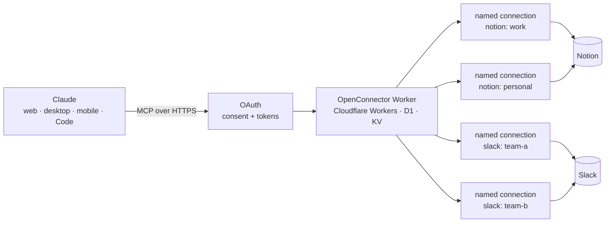

# SplitMind

**One Claude connector, many accounts.** Self-hosted on Cloudflare, built on
[OpenConnector](https://github.com/oomol-lab/open-connector).

> **Status: pre-alpha.** Nothing here is ready to self-host yet. Follow the
> [v0.1 milestone](https://github.com/samfeder/SplitMind/milestone/1) for progress.

## The problem

Claude's connectors hold one account per service. claude.ai keys custom
connectors by URL and rejects a second connector whose URL it already has
([anthropics/claude-ai-mcp#178](https://github.com/anthropics/claude-ai-mcp/issues/178)),
and its connector form offers custom request headers only as a beta for some
organizations. So if you have two Notion workspaces, or two Slack workspaces,
you can only connect one of each.

## How it works

SplitMind is a single self-hosted Claude custom connector that reaches many
accounts of any service. It deploys OpenConnector to your own Cloudflare
account and adds the setup, policy, docs and tests around it. Each account you
connect becomes a **named connection**, and every write names the account it
acts as.

- **Engine:** OpenConnector provides encrypted credential storage, named
  connections, runtime tokens scoped to chosen connections, an action
  allow/block policy, run logs, and five MCP tools: `list_apps`,
  `list_connections`, `search_actions`, `get_action_guide` and
  `execute_action`. SplitMind writes no provider code; gaps are fixed
  upstream.
- **Host:** your Cloudflare account: Workers, D1, KV and Static Assets for the
  Web Console.
- **Sign-in:** Claude connects through OpenConnector's built-in MCP OAuth.
- **v0.1 scope:** two Notion workspaces and two Slack workspaces. The design
  stays general; other providers come later.

## Repository layout

| Path | What it is |
| --- | --- |
| `vendor/open-connector/` | OpenConnector, as a git submodule pinned to a release tag |
| `patches/` | Patches for unmerged upstream fixes, applied at build time only |
| `scripts/` | Bootstrap, setup and deploy scripts |
| `docs/` | Setup guides, provider guides and ADRs |

## Quickstart

_Coming in v0.1._ The quickstart will cover: cloning with submodules, creating
the Cloudflare resources, setting secrets, deploying, and adding SplitMind as a
custom connector in Claude.

## Contributing and security

See [CONTRIBUTING.md](CONTRIBUTING.md). To report a vulnerability, see
[SECURITY.md](SECURITY.md). Never put secrets or tokens in issues.

## License

[Apache-2.0](LICENSE). SplitMind builds on OpenConnector; see [NOTICE](NOTICE).
